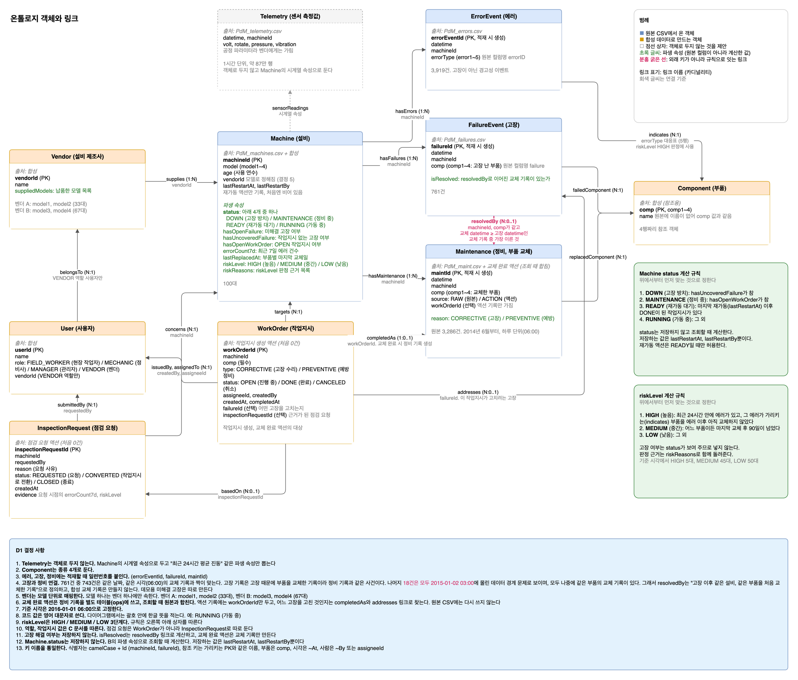

# pdm-ontology

[](https://github.com/boaz-ontology-lab/pdm-ontology/actions/workflows/ci.yml)

Microsoft Azure Predictive Maintenance 데이터 위에 **온톨로지와 데이터 거버넌스 계층**을 얹는 2주 미니 프로젝트다.
설비, 고장, 교체 기록 같은 데이터를 "객체와 링크"로 정의하고, 조회는 자유롭게 하되 쓰기는 권한과 사전조건을 거친 **액션**으로만 하게 만든다.
카탈로그, 태그, 리니지는 OpenMetadata가 맡는다.

## 원칙

- **정의는 한 곳에만 둔다.** 객체, 링크, 액션은 `ontology/*.yaml`에만 정의한다.
- **읽기는 자유, 쓰기는 액션으로만.** 모든 변경은 액션을 거치고 감사 로그를 남긴다.
- **입구는 API 하나.** 사람도 LLM도 같은 API를 쓴다.
- **원본은 읽기 전용.** 액션 결과는 `ops` 스키마에 따로 쓰고, 조회할 때 합친다.

## 객체와 링크



원본은 [docs/diagrams/ontology.drawio](docs/diagrams/ontology.drawio)이고, draw.io로 열어 고친다.

## 폴더 구조

```
pdm-ontology/
├── ontology/            온톨로지 스펙 (objects, links, actions)
├── app/                 FastAPI 앱 (조회 엔진, 액션 엔진, 정책, 가상 시계)
├── infra/               Docker Compose (Postgres, OpenMetadata)
├── db/                  스키마, 뷰, 권한 SQL (data/load.py가 실행)
├── data/                적재, 합성 데이터 스크립트 (원본 CSV는 data/raw/, git 제외)
├── scripts/             개발용 스크립트 (표기 규칙 검사 등)
├── tests/
├── docs/
│   ├── conventions.md   표기 규칙
│   ├── decisions.md     결정 기록
│   └── diagrams/        다이어그램 원본과 PNG
└── .github/             PR, 이슈 템플릿, CI
```

## 역할

| 파트 | 맡는 것 | 주로 만지는 곳 |
|---|---|---|
| A | 데이터 적재, 합성 데이터, DB 스키마, 가상 시계, OpenMetadata | `data/`, `db/` |
| B | 온톨로지 코어: 객체, 링크, 파생 속성, 조회 엔진 | `ontology/objects.yaml`, `ontology/links.yaml`, `app/` 조회 |
| C | 액션: 권한, 사전조건, 실행, 감사 로그 | `ontology/actions.yaml`, `app/` 액션 |

## 시작하기

[uv](https://docs.astral.sh/uv/)가 필요하다.

```bash
make setup    # 의존성 설치
make check    # 린트, 테스트, 표기 규칙 검사 (CI와 같음)
```

| 명령 | 하는 일 |
|---|---|
| `make lint` | ruff 린트와 형식 검사 |
| `make format` | ruff 자동 수정 |
| `make test` | pytest |
| `make conventions` | `ontology/*.yaml`이 표기 규칙을 따르는지 검사 |
| `make up` / `make down` | Postgres, OpenMetadata 실행과 중지 (UI: http://localhost:8585, admin@open-metadata.org / admin) |
| `make up-db` | Postgres만 실행 (가벼움). make가 없으면 `docker compose -f infra/docker-compose.yml up -d postgres` |
| `make om-ingest` | OpenMetadata에 pdm DB의 `raw`, `ref`, `ops`, `core` 수집. `make up`과 `data/load.py` 다음에 실행. make가 없으면 `uv run python scripts/om_ingest.py` |

## 문서

- [협업 규칙](CONTRIBUTING.md): 브랜치, 커밋, PR, 리뷰
- [표기 규칙](docs/conventions.md): 이름, 코드 값, DB, API
- [API 명세](docs/api.md): 공통 규칙, 조회 API, 액션 API, 감사 로그 API
- [결정 기록](docs/decisions.md): 팀에서 정한 것과 아직 정하지 않은 것
